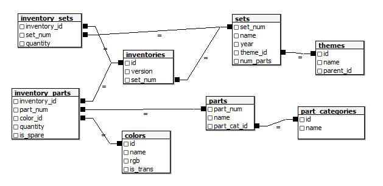

## Objectives {.unnumbered}

This lab accompanies the Week 7 notes, [*SQL for Data Science*](https://soton-fds.github.io/week07.html).

- Read SQL queries, including joins, `GROUP BY` aggregations and `HAVING`, and explain what question they answer.
- Critique a database schema: its primary keys, foreign keys and column types.
- Query a database from `R` using `dbplyr`, and read the SQL that it generates.
- Decide which work to do in the database, and which to do in `R`.

When you have finished the lab, there are more questions on the same data in `lab_07_practice.qmd`, including `WHERE` and `HAVING`, `LEFT JOIN`, a second schema to critique, joining a tibble to a database table, and grouping themes into families.

### Task 1: Reading SQL

The database `data/lego.sqlite` contains information about LEGO sets released between 1950 and 2017, and the parts they contain.
Its schema is shown in the figure below.



In the schema:

- Each box represents a table.
- Each row in a box represents a column in that table.
- Lines joining columns in different tables show primary / foreign key relationships.

The cell below connects to the database and lists its tables.
We will keep this connection open for the whole lab, and close it at the end.

```{r}
library(DBI)
con <- dbConnect(RSQLite::SQLite(), "data/lego.sqlite")
dbListTables(con)
```

In this task you will be *reading* SQL rather than writing it.
Each query is in a `sql` chunk, which runs it against the database `con`, as in the Week 7 notes.
For example, this query returns the first five rows of the `sets` table:

```{sql}
#| connection: con
SELECT * FROM sets LIMIT 5;
```

For each of the four queries below:

- [ ] *Before* running it, write down in one sentence the question that it answers, and how many rows and columns you expect the result to have.
- [ ] Run it, and check your answer.

(Hint: read each query in the order that the database evaluates it, starting at `FROM`. See *Reading SQL Queries* in the Week 7 notes.)

```{sql}
#| connection: con
-- Query 1
SELECT COUNT(*) AS n_sets
FROM sets;
```

```{sql}
#| connection: con
-- Query 2
SELECT name, year, num_parts
FROM sets
ORDER BY num_parts DESC
LIMIT 5;
```

```{sql}
#| connection: con
-- Query 3
SELECT year, COUNT(*) AS n_sets
FROM sets
GROUP BY year
ORDER BY n_sets DESC
LIMIT 1;
```

```{sql}
#| connection: con
-- Query 4
SELECT COUNT(*) AS n_parts
FROM parts
    JOIN part_categories ON parts.part_cat_id = part_categories.id
WHERE part_categories.name = 'Minifigs';
```

::: {.solution}

1. *How many sets are in the database?* One row and one column: there are 11,673 sets.
2. *Which five sets have the most parts, and in which year was each released?* Five rows and three columns. `ORDER BY num_parts DESC` sorts the sets from largest to smallest, and `LIMIT 5` keeps the first five. The largest is the Taj Mahal (5,922 parts). Note that not every "set" is a boxed model: the Window Exploration Bag is a bag of loose parts.
3. *In which year were the most sets released, and how many?* `GROUP BY year` makes one row per year, `COUNT(*)` counts the sets in each, and `ORDER BY ... LIMIT 1` keeps the year with the largest count: one row and two columns, 713 sets in 2014. (If two years had tied, `LIMIT 1` would hide one of them.)
4. *How many different parts are in the "Minifigs" category?* The join attaches each part's category to it, and `WHERE` keeps the parts whose category is called `Minifigs`: 8,556 parts. Each row of `parts` is a different part, because `part_num` is its primary key, so this counts *different* parts rather than the number of minifig pieces that have been made.

Whether 8,556 is the answer to "how many minifig parts are there?" depends on what you count as a minifig part: two other categories also contain figures and their accessories.

```{sql}
#| connection: con
SELECT * FROM part_categories WHERE id IN (13, 27, 57);
```

:::

A colleague wants to know which LEGO theme has the most sets.
They have written two queries, which give different answers.

```{sql}
#| connection: con
-- Query A
SELECT themes.name, COUNT(*) AS n_sets
FROM sets
    JOIN themes ON sets.theme_id = themes.id
GROUP BY themes.id, themes.name
ORDER BY n_sets DESC
LIMIT 5;
```

```{sql}
#| connection: con
-- Query B
SELECT themes.name, COUNT(*) AS n_sets
FROM sets
    JOIN themes ON sets.theme_id = themes.id
GROUP BY themes.name
ORDER BY n_sets DESC
LIMIT 5;
```

- [ ] Explain in words what each query computes. Why do they give different answers? (Hint: run the query below.)
- [ ] Which theme comes top in Query A? Use the second query below to look at some of its sets. Is "the theme with the most sets" a good way to find the most popular theme?

```{sql}
#| connection: con
SELECT * FROM themes WHERE name = 'Technic';
```

```{sql}
#| connection: con
SELECT name, year, num_parts FROM sets WHERE theme_id = 501 LIMIT 10;
```

::: {.solution}

Query A groups the sets by theme `id`, so it answers *which five themes have the most sets?*, treating every row of `themes` as a separate theme.
Query B groups by theme `name`, so it answers *which five theme names are shared by the most sets?*: themes with the same name are merged into a single group.

The two differ because theme names are not unique.
There are six different themes called `Technic`, each with a different parent theme, and Query B adds their sets together.
Only `id`, the primary key, is guaranteed to identify a single theme.

Neither query really tells us which theme is the most *popular*.
The top theme in Query A is `Gear`, which is LEGO merchandise (watches, clocks, storage boxes), and most of its "sets" have no parts at all.
Fourth in Query A is a theme called `City` (id 220), but its parent is `Advent Sub-Set`: each of its "sets" is a single day of a City advent calendar.
In Query B, `Supplemental` comes top, and its sets are packs of spare bricks.
A count of sets measures how many products were released, not how many were sold, and the database contains no sales data at all.
:::

Next, we look at how the database is structured.
Each line in the schema figure joins a column in one table to a column in another.

- [ ] For each line in the schema figure, say which two tables it connects, and whether the relationship between them is one-to-one, one-to-many, many-to-one or many-to-many. (See the Week 5 notes for one-to-many and many-to-many relationships.)
- [ ] You might expect each set to have exactly one inventory: the list of parts in the set. Read the first query below: what does it tell you? Use the second query to look at one example.
- [ ] `sets` and `parts` are not joined by a line, but are still related. What is the relationship between them, and through which tables?
- [ ] What is the table `inventory_sets` for? (Hint: read and run the third query below.)

```{sql}
#| connection: con
SELECT set_num, COUNT(*) AS n_inventories
FROM inventories
GROUP BY set_num
ORDER BY n_inventories DESC
LIMIT 5;
```

```{sql}
#| connection: con
SELECT * FROM inventories WHERE set_num = '421-2';
```

```{sql}
#| connection: con
SELECT sets.name, inventory_sets.set_num, inventory_sets.quantity
FROM inventory_sets
    JOIN inventories ON inventory_sets.inventory_id = inventories.id
    JOIN sets ON inventories.set_num = sets.set_num
LIMIT 6;
```

::: {.solution}

Every line in the figure joins a foreign key to the primary key of another table:

| Line | Relationship |
|:-----|:-------------|
| `themes.id` -- `sets.theme_id` | One theme has many sets; each set has one theme. |
| `part_categories.id` -- `parts.part_cat_id` | One category has many parts; each part has one category. |
| `sets.set_num` -- `inventories.set_num` | One set has many inventories; each inventory belongs to one set. |
| `inventories.id` -- `inventory_parts.inventory_id` | One inventory has many rows in `inventory_parts`; each row belongs to one inventory. |
| `parts.part_num` -- `inventory_parts.part_num` | One part has many rows in `inventory_parts`; each row is for one part. |
| `colors.id` -- `inventory_parts.color_id` | One colour has many rows in `inventory_parts`; each row is in one colour. |
| `inventories.id` -- `inventory_sets.inventory_id` | One inventory has many rows in `inventory_sets`; each row belongs to one inventory. |
| `sets.set_num` -- `inventory_sets.set_num` | One set has many rows in `inventory_sets`; each row is for one set. |

So every line is one-to-many, read from the primary key to the foreign key (or many-to-one, read the other way).
This is no accident: a primary key is unique, so each row on the foreign key side can match only one row on the primary key side, whereas nothing stops many rows from sharing the same foreign key value.

The query counts the inventories of each set, and shows that set `421-2` has five, which are different *versions* of its parts list.
Only 8 sets have more than one inventory (and 3 have none), so the relationship is *almost* one-to-one, but the database allows one-to-many.
This matters when joining: a query that joins `sets` to `inventories` would count set `421-2` five times.

`sets` and `parts` are many-to-many: a set contains many different parts, and a part appears in many sets.
A single line cannot represent this, because a column holds one value in each row.
Instead, it goes through a linking table with one row for each combination: each set has an inventory (`inventories`), and `inventory_parts` has a row for each part, in each colour, in each inventory.
This is why the natural key of `inventory_parts` combines several columns, as we will see next.

`inventory_sets` is another linking table, for sets that contain other sets.
The third query joins each of its rows to the inventory, and then to the set that the inventory belongs to, giving the name of the containing set alongside each set it contains.
For example, the inventory of the *Star Wars Super Pack 2 in 1* contains the two sets 75048 and 75053.
An inventory can contain many sets (up to 30) and a set can appear in many inventories (up to 12), so this relationship between `inventories` and `sets` is many-to-many too.
:::

Finally, here is the `CREATE TABLE` statement that was used to create `inventory_parts`.
(SQLite stores these statements in a special table called `sqlite_master`; we have tidied up its formatting.)

```sql
CREATE TABLE inventory_parts (
    inventory_id INTEGER,
    part_num TEXT,
    color_id INTEGER,
    quantity INTEGER,
    is_spare TEXT,
    FOREIGN KEY (color_id) REFERENCES colors(id),
    FOREIGN KEY (inventory_id) REFERENCES inventories(id),
    FOREIGN KEY (part_num) REFERENCES parts(part_num)
);
```

- [ ] `inventory_parts` has no primary key. What problems could this cause?
- [ ] Suggest a primary key for `inventory_parts`. (Hint: no single column will do.)
- [ ] The first query below tests one possible key. What does it count, and what does its result tell you? Use the second query to see an example, and improve your key if you need to.

```{sql}
#| connection: con
SELECT COUNT(*) AS n_repeated
FROM (
    SELECT inventory_id, part_num, color_id
    FROM inventory_parts
    GROUP BY inventory_id, part_num, color_id
    HAVING COUNT(*) > 1
);
```

```{sql}
#| connection: con
SELECT *
FROM inventory_parts
WHERE inventory_id = 3 AND part_num = '33291' AND color_id = 191;
```

::: {.solution}

Without a primary key, nothing stops the same row from being inserted twice, which would double-count parts.
There is also no way to identify one particular row, for example to `UPDATE` or `DELETE` it, other than by listing all of its values.

Each row of `inventory_parts` says how many of one part, in one colour, are in one inventory, so a natural key combines `inventory_id`, `part_num` and `color_id`.
The query groups the rows by these three columns, keeps the groups with more than one row, and counts those groups: 27,324 combinations appear more than once, so these three columns are not a valid key.
The example shows why: inventory 3 contains three of part 33291 in colour 191, plus one more as a *spare*.
Adding `is_spare` to the key fixes this: no combination of all four columns is repeated, so `PRIMARY KEY (inventory_id, part_num, color_id, is_spare)` would be a valid key.
:::

### Task 2: Using `dbplyr`

In this task we query the same database using `dplyr` code, which `dbplyr` translates into SQL.
The cell below creates a lazy table for each of the tables we need.

```{r}
#| message: false
library(tidyverse)
library(dbplyr)

sets <- tbl(con, "sets")
themes <- tbl(con, "themes")
inventory_parts <- tbl(con, "inventory_parts")
```

- [ ] Print `sets`. What does the `??` in the first line of the output mean, and why doesn't `dbplyr` know the answer?

::: {.solution}

```{r}
sets
```

`sets` is a lazy table: `dbplyr` has only fetched the first few rows, to show us, so it does not know how many rows the table has without running another query.
:::

- [ ] Write `dplyr` code that answers the same question as Query 3 from Task 1. Use `show_query()` to compare the SQL that `dbplyr` generates with Query 3.

::: {.solution}

```{r}
year_most_sets <- sets |>
    group_by(year) |>
    summarise(n_sets = n()) |>
    arrange(desc(n_sets)) |>
    head(1)

show_query(year_most_sets)
collect(year_most_sets)
```

The generated SQL is the same as Query 3, apart from the backticks around names.
:::

- [ ] Write `dplyr` code to count the *top-level* themes, which have no parent. Use `show_query()` to see how `dbplyr` translates your code. Why would `filter(parent_id == NA)` not work?

::: {.solution}

```{r}
top_level <- themes |>
    filter(is.na(parent_id)) |>
    summarise(n_top_level = n())

show_query(top_level)
collect(top_level)
```

`dbplyr` translates `is.na(parent_id)` into `parent_id IS NULL`.
`parent_id == NA` would compare each value with "unknown", which is never true, in `R` as well as in SQL; it is translated to `parent_id = NULL`, and keeps no rows:

```{r}
themes |>
    filter(parent_id == NA) |>
    summarise(n_top_level = n()) |>
    collect()
```

:::

Next, we ask: are LEGO sets getting bigger?

- [ ] Calculate the mean number of parts per set in each year, in the database, then collect the result and plot it.
- [ ] 473 sets have `num_parts` equal to 0. Find which themes most of these sets belong to. Should they be included in the mean? Redraw your plot without them.
- [ ] What do you conclude? Look at the spike around 1960, and at the most recent year: how many sets is each point based on?

::: {.solution}

```{r}
sets |>
    group_by(year) |>
    summarise(mean_parts = mean(num_parts, na.rm = TRUE), .groups = "drop") |>
    collect() |>
    ggplot(aes(x = year, y = mean_parts)) +
    geom_line() +
    labs(x = "Year", y = "Mean number of parts per set")
```

Everything before `collect()` runs in the database, so only one row per year is sent to `R`; `ggplot` then runs in `R`.
(Without `na.rm = TRUE`, `dbplyr` warns that SQL always removes missing values when it aggregates.)

```{r}
sets |>
    filter(num_parts == 0) |>
    count(theme_id) |>
    inner_join(themes, by = c("theme_id" = "id")) |>
    arrange(desc(n)) |>
    head(5) |>
    collect()
```

Most of the sets with no parts are `Gear`, key chains and books: they are not building sets, so they should be left out of an average set size.

```{r}
sets |>
    filter(num_parts > 0) |>
    group_by(year) |>
    summarise(mean_parts = mean(num_parts, na.rm = TRUE), .groups = "drop") |>
    collect() |>
    ggplot(aes(x = year, y = mean_parts)) +
    geom_line() +
    labs(x = "Year", y = "Mean number of parts per set")
```

Sets have grown: the mean number of parts has risen from under 50 in the 1950s to over 200 in the 2010s.
Not every point is equally reliable, though.
Counting the sets behind each mean shows that the spike in 1960 is based on just two sets, one of which has 476 parts:

```{r}
sets |>
    filter(num_parts > 0, year %in% c(1959, 1960, 1961, 2016, 2017)) |>
    group_by(year) |>
    summarise(
        n_sets = n(),
        mean_parts = mean(num_parts, na.rm = TRUE),
        .groups = "drop"
    ) |>
    collect()
```

The data also stop part of the way through 2017, so the last point is based on about half as many sets as 2016, and these may not be a typical selection of the year's sets.
:::

Finally, we compare doing the work in the database with doing it in `R`.
Both of the pipelines below count the total number of parts of each colour.

```{r}
#| eval: false
# Pipeline 1
inventory_parts |>
    group_by(color_id) |>
    summarise(total = sum(quantity, na.rm = TRUE), .groups = "drop") |>
    collect()

# Pipeline 2
inventory_parts |>
    collect() |>
    group_by(color_id) |>
    summarise(total = sum(quantity), .groups = "drop")
```

- [ ] Which pipeline would you use, and why?
- [ ] Try calculating the 90th percentile of `num_parts` with `quantile()` in the database. What happens? How can you fix it?

::: {.solution}

Both give the same result, but Pipeline 1 is better.
It sums the quantities in the database and sends `R` one row per colour, whereas Pipeline 2 first copies all 580,069 rows of `inventory_parts` into `R`.

`quantile()` has no translation into SQLite's SQL, so the query fails:

```{r}
#| error: true
sets |>
    summarise(p90 = quantile(num_parts, 0.9)) |>
    collect()
```

To fix it, we collect just the column we need, and calculate the percentile in `R`:

```{r}
sets |>
    select(num_parts) |>
    collect() |>
    summarise(p90 = quantile(num_parts, 0.9))
```

:::

We have finished with the database, so we close the connection:

```{r}
dbDisconnect(con)
```

## Finished? {.unnumbered}

Carry on with the questions in `lab_07_practice.qmd`.
