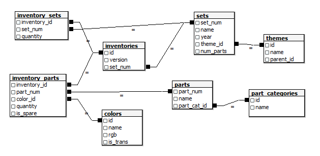

## Objectives {.unnumbered}

This lab accompanies the Week 7 notes, [*SQL for Data Science*](https://soton-fds.github.io/week07.html).

- Read SQL queries, including joins, `GROUP BY` aggregations and `HAVING`, and explain what question they answer.
- Critique a database schema: its primary keys, foreign keys and column types.
- Query a database from `R` using `dbplyr`, and read the SQL that it generates.
- Decide which work to do in the database, and which to do in `R`.

When you have finished the lab, there are more questions on the same data in `lab_07_practice.qmd`, including `WHERE` and `HAVING`, `LEFT JOIN`, a second schema to critique, joining a tibble to a database table, and grouping themes into families.

### Task 1: Reading SQL

The database `data/lego.sqlite` contains information about LEGO sets released between 1950 and 2017, and the parts they contain.
Its schema is shown in the figure below.



In the schema:

- Each box represents a table.
- Each row in a box represents a column in that table.
- Lines joining columns in different tables show primary / foreign key relationships.

The cell below connects to the database and lists its tables.
We will keep this connection open for the whole lab, and close it at the end.

```{r}
library(DBI)
con <- dbConnect(RSQLite::SQLite(), "data/lego.sqlite")
dbListTables(con)
```

In this task you will be *reading* SQL rather than writing it.
Each query is in a `sql` chunk, which runs it against the database `con`, as in the Week 7 notes.
For example, this query returns the first five rows of the `sets` table:

```{sql}
#| connection: con
SELECT * FROM sets LIMIT 5;
```

For each of the four queries below:

- [ ] *Before* running it, write down in one sentence the question that it answers, and how many rows and columns you expect the result to have.
- [ ] Run it, and check your answer.

(Hint: read each query in the order that the database evaluates it, starting at `FROM`. See *Reading SQL Queries* in the Week 7 notes.)

```{sql}
#| connection: con
-- Query 1
SELECT COUNT(*) AS n_sets
FROM sets;
```

```{sql}
#| connection: con
-- Query 2
SELECT name, year, num_parts
FROM sets
ORDER BY num_parts DESC
LIMIT 5;
```

```{sql}
#| connection: con
-- Query 3
SELECT year, COUNT(*) AS n_sets
FROM sets
GROUP BY year
ORDER BY n_sets DESC
LIMIT 1;
```

```{sql}
#| connection: con
-- Query 4
SELECT COUNT(*) AS n_parts
FROM parts
    JOIN part_categories ON parts.part_cat_id = part_categories.id
WHERE part_categories.name = 'Minifigs';
```

::: {.solution}

:::

A colleague wants to know which LEGO theme has the most sets.
They have written two queries, which give different answers.

```{sql}
#| connection: con
-- Query A
SELECT themes.name, COUNT(*) AS n_sets
FROM sets
    JOIN themes ON sets.theme_id = themes.id
GROUP BY themes.id, themes.name
ORDER BY n_sets DESC
LIMIT 5;
```

```{sql}
#| connection: con
-- Query B
SELECT themes.name, COUNT(*) AS n_sets
FROM sets
    JOIN themes ON sets.theme_id = themes.id
GROUP BY themes.name
ORDER BY n_sets DESC
LIMIT 5;
```

- [ ] Explain in words what each query computes. Why do they give different answers? (Hint: run the query below.)
- [ ] Which theme comes top in Query A? Use the second query below to look at some of its sets. Is "the theme with the most sets" a good way to find the most popular theme?

```{sql}
#| connection: con
SELECT * FROM themes WHERE name = 'Technic';
```

```{sql}
#| connection: con
SELECT name, year, num_parts FROM sets WHERE theme_id = 501 LIMIT 10;
```

::: {.solution}

:::

Next, we look at how the database is structured.
Each line in the schema figure joins a column in one table to a column in another.

- [ ] For each line in the schema figure, say which two tables it connects, and whether the relationship between them is one-to-one, one-to-many, many-to-one or many-to-many. (See the Week 5 notes for one-to-many and many-to-many relationships.)
- [ ] You might expect each set to have exactly one inventory: the list of parts in the set. Read the first query below: what does it tell you? Use the second query to look at one example.
- [ ] `sets` and `parts` are not joined by a line, but are still related. What is the relationship between them, and through which tables?
- [ ] What is the table `inventory_sets` for? (Hint: read and run the third query below.)

```{sql}
#| connection: con
SELECT set_num, COUNT(*) AS n_inventories
FROM inventories
GROUP BY set_num
ORDER BY n_inventories DESC
LIMIT 5;
```

```{sql}
#| connection: con
SELECT * FROM inventories WHERE set_num = '421-2';
```

```{sql}
#| connection: con
SELECT sets.name, inventory_sets.set_num, inventory_sets.quantity
FROM inventory_sets
    JOIN inventories ON inventory_sets.inventory_id = inventories.id
    JOIN sets ON inventories.set_num = sets.set_num
LIMIT 6;
```

::: {.solution}

:::

Finally, here is the `CREATE TABLE` statement that was used to create `inventory_parts`.
(SQLite stores these statements in a special table called `sqlite_master`; we have tidied up its formatting.)

```sql
CREATE TABLE inventory_parts (
    inventory_id INTEGER,
    part_num TEXT,
    color_id INTEGER,
    quantity INTEGER,
    is_spare TEXT,
    FOREIGN KEY (color_id) REFERENCES colors(id),
    FOREIGN KEY (inventory_id) REFERENCES inventories(id),
    FOREIGN KEY (part_num) REFERENCES parts(part_num)
);
```

- [ ] `inventory_parts` has no primary key. What problems could this cause?
- [ ] Suggest a primary key for `inventory_parts`. (Hint: no single column will do.)
- [ ] The first query below tests one possible key. What does it count, and what does its result tell you? Use the second query to see an example, and improve your key if you need to.

```{sql}
#| connection: con
SELECT COUNT(*) AS n_repeated
FROM (
    SELECT inventory_id, part_num, color_id
    FROM inventory_parts
    GROUP BY inventory_id, part_num, color_id
    HAVING COUNT(*) > 1
);
```

```{sql}
#| connection: con
SELECT *
FROM inventory_parts
WHERE inventory_id = 3 AND part_num = '33291' AND color_id = 191;
```

::: {.solution}

:::

### Task 2: Using `dbplyr`

In this task we query the same database using `dplyr` code, which `dbplyr` translates into SQL.
The cell below creates a lazy table for each of the tables we need.

```{r}
#| message: false
library(tidyverse)
library(dbplyr)

sets <- tbl(con, "sets")
themes <- tbl(con, "themes")
inventory_parts <- tbl(con, "inventory_parts")
```

- [ ] Print `sets`. What does the `??` in the first line of the output mean, and why doesn't `dbplyr` know the answer?

::: {.solution}

:::

- [ ] Write `dplyr` code that answers the same question as Query 3 from Task 1. Use `show_query()` to compare the SQL that `dbplyr` generates with Query 3.

::: {.solution}

:::

- [ ] Write `dplyr` code to count the *top-level* themes, which have no parent. Use `show_query()` to see how `dbplyr` translates your code. Why would `filter(parent_id == NA)` not work?

::: {.solution}

:::

Next, we ask: are LEGO sets getting bigger?

- [ ] Calculate the mean number of parts per set in each year, in the database, then collect the result and plot it.
- [ ] 473 sets have `num_parts` equal to 0. Find which themes most of these sets belong to. Should they be included in the mean? Redraw your plot without them.
- [ ] What do you conclude? Look at the spike around 1960, and at the most recent year: how many sets is each point based on?

::: {.solution}

:::

Finally, we compare doing the work in the database with doing it in `R`.
Both of the pipelines below count the total number of parts of each colour.

```{r}
#| eval: false
# Pipeline 1
inventory_parts |>
    group_by(color_id) |>
    summarise(total = sum(quantity, na.rm = TRUE), .groups = "drop") |>
    collect()

# Pipeline 2
inventory_parts |>
    collect() |>
    group_by(color_id) |>
    summarise(total = sum(quantity), .groups = "drop")
```

- [ ] Which pipeline would you use, and why?
- [ ] Try calculating the 90th percentile of `num_parts` with `quantile()` in the database. What happens? How can you fix it?

::: {.solution}

:::

We have finished with the database, so we close the connection:

```{r}
dbDisconnect(con)
```

## Finished? {.unnumbered}

Carry on with the questions in `lab_07_practice.qmd`.
